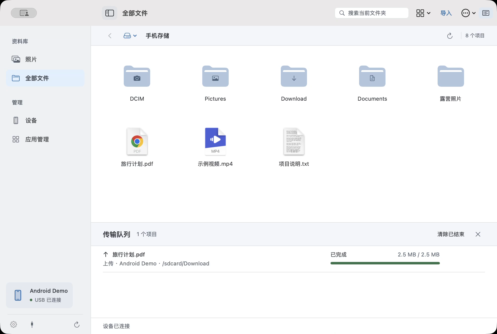
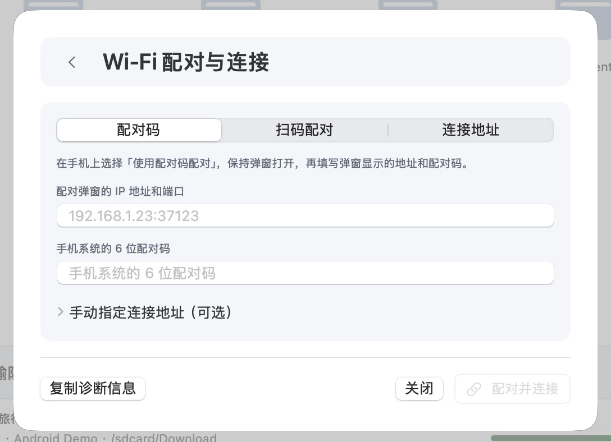
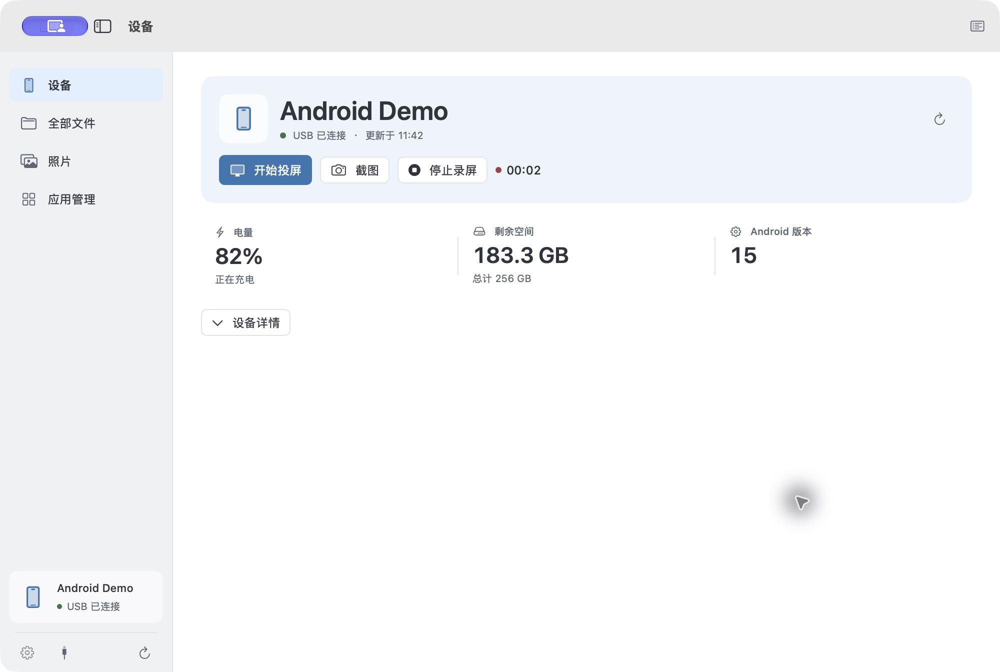

# DroidHub

原生 macOS 工具，通过 USB 或 Wi‑Fi 管理 Android 手机。支持文件传输、照片和视频、应用管理、设备信息、投屏、截图和录屏。

**[下载 DroidHub 最新正式版](https://github.com/wzebbin/DroidHub/releases/latest)** · 适用于 Apple 芯片 Mac（arm64）。最低构建目标为 macOS 13，macOS 13 实机兼容性尚待验证。 [验证记录](docs/VALIDATION.md)



## 下载与安装

安装包内置 ADB 和 scrcpy，手机无需安装配套应用。

1. 从 Release 页下载 Apple 芯片版 ZIP 和对应的 `.zip.sha256`，放在同一目录。以 0.3.117 为例，在该目录运行 `shasum -a 256 -c DroidHub-0.3.117-macOS-arm64.zip.sha256` 校验。
2. 解压 ZIP，将 `DroidHub.app` 拖入「应用程序」。
3. 安装包使用 ad-hoc 签名，未经 Apple 公证，macOS 首次打开时可能拦截。确认下载来源和校验结果后，如果「系统设置 → 隐私与安全性」提供「仍要打开」，可从那里打开。

从 0.3.117 起，DroidHub 默认在主窗口打开后后台检查正式版，每 5 小时最多自动检查一次。发现新版时会提示，并提供发布页入口。可在「设置 → 软件更新」关闭启动检查或开启「检查开发预览版」。手动检查随时可用。

安装更新时，先完成或暂停传输并退出 DroidHub，再从 GitHub Releases 下载并替换「应用程序」中的旧版。 [GitHub Releases](https://github.com/wzebbin/DroidHub/releases)

也可以[从源码构建](#从源码构建)。

## 首次连接

- **USB**：用支持数据传输的线连接手机，解锁并在「开发者选项」开启 USB 调试。手机出现「允许 USB 调试」时点「允许」。若未出现弹窗，重新插拔数据线并看一下手机屏幕。
- **Wi‑Fi**：手机和 Mac 连同一 Wi‑Fi。在手机「开发者选项 → 无线调试」（Android 11+）开启开关，在 DroidHub 选择「连接设备 → 配对新设备」。可用手机扫码，也可在手机打开「使用配对码配对」，保持弹窗打开，填写其中的地址和六位数字。
- **已配对但找不到**：用「输入连接地址」填写手机无线调试主页当前显示的 IP 和端口。重新开启无线调试后请读取新端口。若 Mac 拒绝过局域网访问，可在「系统设置 → 隐私与安全性 → 本地网络」允许 DroidHub 后重试。



## 主要功能

- 「设备」查看电量、存储和系统信息。点「开始投屏」打开独立窗口。连接手机后也可直接截图或录屏，录屏支持实时计时，停止后保存为 MP4。当前投屏和录屏只处理画面。
- 「全部文件」支持 Finder 拖入、文件和文件夹双向传输、批量移动和重命名、回收站和恢复。常用目录可收藏到侧栏，同一台手机通过 USB 或 Wi‑Fi 连接时共用收藏。在 DroidHub 内移动或重命名目录后，相关收藏会随路径更新。
- 「传输队列」支持暂停、继续和取消，手动暂停状态在重启后保留。退出或断线后，重新连接原手机并点「重试未完成任务」。也可在「设置 → 文件传输」开启「重连后自动继续」，恢复因断线中断的任务。文件夹任务显示已完成的文件数和当前文件名。
- 上传和下载均支持 64 MiB 起的文件断点续传。重试文件夹任务时，校验一致的文件会跳过，较小的未完成文件会从头传，空目录会保留。整个目录的结构和逐文件 SHA-256 校验通过后才保存。
- 「照片」支持日期分组、相册、搜索、照片预览、视频播放和导出原文件。
- 「应用管理」支持按应用名称或包名搜索，查看版本、大小，安装、启动、卸载和导出安装包。拆分应用导出为包含各 APK 的 ZIP，应用数据不包含在内。
- 在「设置」选择浅色、深色或跟随系统，即时切换简体中文和英语，并可设置关闭主窗口时直接退出、隐藏窗口或每次询问。「关于软件」显示版本和构建号，也可以手动检查更新。



## 目录

```text
macOS/       Swift Package，可用 Xcode 打开 Package.swift
  Sources/DroidHub/       原生桌面界面、操作状态
  Sources/DroidHubCore/   ADB、子进程、照片扫描和导出
  Helpers/               随 Mac 应用打包、通过 ADB 调用的 Android 文件操作和应用元数据工具
  Tests/                 设备解析、特殊文件名、shell 引用测试
scripts/     Mac 构建与测试脚本
docs/        发布版本验证记录
dist/        本地构建产物（不提交）
```

## 从源码构建

0.3.117 在 Apple 芯片 Mac 上使用 Xcode 27.2（Swift 6.4.2）构建。打包还需要 Android NDK 28.2.13676358、Android SDK Platform 34、Build Tools 36.0.0 和 JDK 17 或更新版本。Android SDK 默认位于 `~/Library/Android/sdk`，可用 `ANDROID_SDK_ROOT` 指定其他位置。可用 `ANDROID_NDK_HOME` 指定 NDK 目录，用 `JAVA_HOME` 指定 JDK 目录。

可以克隆仓库，也可以在 GitHub 仓库页面下载源码 ZIP 并解压。首次打包需要联网获取 ADB 和 scrcpy。

```bash
git clone https://github.com/wzebbin/DroidHub.git
cd DroidHub
```

在项目根目录运行以下命令。

```bash
./scripts/test-macos.sh
./scripts/build-macos.sh
open dist/DroidHub.app
```

日常开发可用 Xcode 打开 `macOS/Package.swift` 并运行 DroidHub target。完整功能验收请启动脚本生成的 `dist/DroidHub.app`，其中包含 ADB、scrcpy 和 Android 辅助工具。

构建脚本按目标架构从官方来源获取并校验固定版本的 ADB 和 scrcpy，缓存至 `.build/bundled-tools`，并打包到 `DroidHub.app`。应用默认使用内置工具，可用的自定义路径会优先使用。打开 **DroidHub → Settings（⌘,）** 可查看当前状态，在「高级设置」可修改路径或恢复内置路径。

## 手动发布

1. 在 Apple 芯片 Mac 上运行 `./scripts/test-macos.sh` 和 `./scripts/build-macos.sh --release`。验收 `dist/` 下的 ZIP 和 SHA‑256。
2. 根据第三方声明核对随包组件和对应分发材料。GitHub Release 使用与构建对应的标签（如 `v0.3.117`），附上安装包、校验文件和适用的第三方材料。scrcpy 源码附件包含对应源码、重链脚本和使用说明，和安装包放在同一 Release。 [项目许可证](LICENSE) · [第三方声明](licenses/README.md) · [GitHub Releases](https://github.com/wzebbin/DroidHub/releases)

## 反馈

报告问题时，请注明 DroidHub 版本、macOS 版本、手机型号、Android 版本、USB 或 Wi‑Fi 连接方式，以及复现步骤。连接问题可以附上「连接设备 → 复制诊断信息」的输出。 [GitHub Issues](https://github.com/wzebbin/DroidHub/issues)

## 许可

DroidHub 源码采用 MIT 许可证。随包第三方组件按各自的许可证分发。 [项目许可证](LICENSE) · [第三方声明](licenses/README.md)

## 当前限制

- 图库读取 `DCIM` 和 `Pictures` 中可访问的媒体，视频也扫描 `Movies`。首次批量读取原图的速度取决于连接和文件大小。
- 文件列表一次读取整个目录。目录内含符号链接或特殊文件时会提示无法传输。
- 如果上传时手机断开且无法清理，界面会提示需要检查的临时文件路径。
- ADB 访问范围由手机权限决定，不提供 root 或读取其他应用私有数据的能力。
- 不同厂商手机的存储访问范围有待验证。

本次构建及真机测试范围见[验证记录](docs/VALIDATION.md)。
